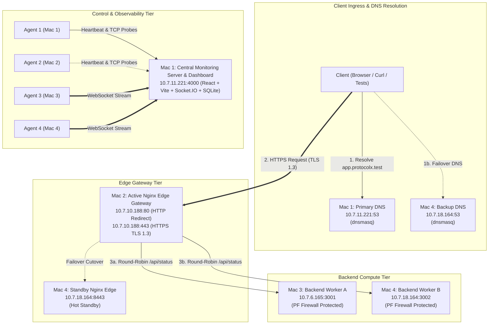

# PROTOCOLX PHASE 2 — DISTRIBUTED SYSTEM ARCHITECTURE

**System Version:** Phase 2.0 (Multi-Mac Distributed Architecture)  
**Network Subnet:** `10.7.0.0/19` (Private Campus Wi-Fi/LAN)  
**Integration Lead:** Naveen (Mac 1)  
**Date:** November 24, 2026  

---

## 1. Architectural Overview

ProtocolX Phase 2 evolves the single-host simulation of Phase 1 into a distributed system operating across four physical Apple Mac computers connected to the same private subnet (`10.7.0.0/19`). 

The architecture separates responsibilities into four distinct network tiers:
1. **Control & Integration Tier (Mac 1 — Naveen):** Hosts the Central Monitoring Server, Real-time WebSocket Gateway, React Control Center, and Primary DNS.
2. **Edge Ingress Tier (Mac 2 — Shagun):** Nginx reverse proxy terminating TLS 1.3, enforcing HTTP-to-HTTPS redirection, caching GET responses, and round-robin load balancing across worker nodes.
3. **Primary Compute Tier (Mac 3 — Archit):** Node.js Backend Application Worker A on port 3001, subject to PF firewall service isolation.
4. **Redundant Compute & Resilience Tier (Mac 4 — Aditya):** Node.js Backend Application Worker B on port 3002, secondary redundant DNS server on port 53, and Standby Edge gateway.

---

## 2. Distributed Network Topology

---

## 3. Physical Node Allocations & Network Matrix

| Node | Physical Hostname | IP Address | MAC (ether) | Primary Role | Active Ports |
| :--- | :--- | :--- | :--- | :--- | :--- |
| **Mac 1** | `naveen-3.local` | `10.7.11.221` | `12:f3:d6:58:21:ee` | Primary DNS, Central Monitor, Web UI | `53` (UDP/TCP), `4000` (TCP) |
| **Mac 2** | `rahul.local` | `10.7.10.188` | `4e:75:48:29:07:cf` | Nginx Edge Gateway, TLS Terminator | `80` (HTTP), `443` (HTTPS) |
| **Mac 3** | `Archits-MacBook-Pro-4.local` | `10.7.6.165` | `8c:85:90:39:ec:9d` | Backend A Worker, PF Protected | `3001` (TCP) |
| **Mac 4** | `vk.local` | `10.7.18.164` | `6c:3e:6d:15:3e:7b` | Backend B Worker, Backup DNS, Standby Edge | `3002` (TCP), `53` (UDP/TCP), `8443` (Standby) |

---

## 4. End-to-End Traffic Flows

### 4.1 Client DNS Resolution Flow
1. Client requests resolution for `app.protocolx.test`.
2. macOS resolver queries `/etc/resolver/test` pointing to `127.0.0.1` and `10.7.11.221`.
3. `dnsmasq` responds with `A 10.7.10.188` (Mac 2 Nginx Edge).
4. If Mac 1 is offline or silent, the client queries secondary nameserver `10.7.18.164` (Mac 4 Backup DNS) and receives the identical `10.7.10.188` record.

### 4.2 Application HTTPS Ingress & Load Balancing Flow
1. Client connects to `https://app.protocolx.test/api/status` over TCP port 443.
2. Mac 2 Edge performs TLS 1.3 handshake using `tls/app.protocolx.test.crt`.
3. Nginx upstream block `protocolx_backends` selects an upstream worker via round-robin:
   - Request 1 $\rightarrow$ `10.7.6.165:3001` (Backend A) $\rightarrow$ `X-Backend: A`.
   - Request 2 $\rightarrow$ `10.7.18.164:3002` (Backend B) $\rightarrow$ `X-Backend: B`.
4. Response caching: For `/api/status`, Nginx attaches `Cache-Control: public, max-age=10`.
5. Failover logic: If Backend A stops responding, `proxy_next_upstream error timeout http_502 http_503` routes the pending connection to Backend B within 2 seconds without exposing errors to the client.

### 4.3 Real-Time Monitoring & Telemetry Stream Flow
1. Each remote node runs `agent/agent.js` background daemon.
2. Agents initiate persistent bi-directional WebSocket connections to `ws://10.7.11.221:4000`.
3. Every 5 seconds, agents probe local service ports (`net.Socket`), gather system metrics (load average, uptime, memory), and emit structured reports to the server.
4. The server validates payloads, logs state changes to SQLite, and broadcasts real-time socket events (`status-update`, `new-log`) to connected dashboard browser sessions.
