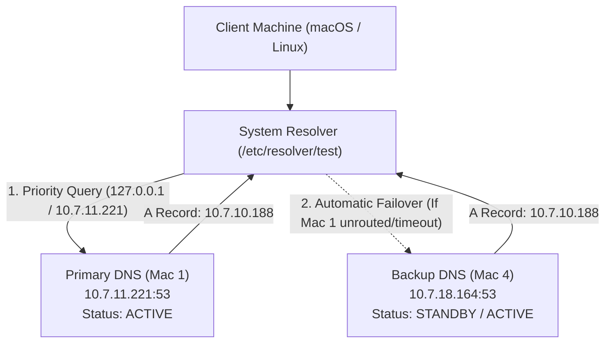

# PROTOCOLX PHASE 2 — DNS REDUNDANCY, FAILOVER & TTL DYNAMICS

**Document Version:** 2.0.0  
**Primary Nameserver:** Mac 1 (`10.7.11.221`)  
**Secondary Nameserver:** Mac 4 (`10.7.18.164`)  
**Lead:** Naveen (Mac 1) & Aditya (Mac 4)  
**Date:** November 24, 2026  

---

## 1. High-Availability DNS Topology

In Phase 1, DNS was a single point of failure (SPOF) residing entirely on one host. In Phase 2, DNS is distributed across two independent physical hosts:



Both nameservers are configured with synchronized zone definitions for `app.protocolx.test -> 10.7.10.188` (Mac 2 Nginx Edge).

---

## 2. Configuration Specifications

### Primary DNS Configuration (`dns/dnsmasq.conf` on Mac 1)
```ini
port=53
listen-address=127.0.0.1,10.7.11.221
bind-interfaces
domain-needed
bogus-priv
no-resolv
server=1.1.1.1
server=8.8.8.8
local-ttl=30
address=/app.protocolx.test/10.7.10.188
host-record=migration.protocolx.test,10.7.10.188,30
```

### Backup DNS Configuration (`dns/dnsmasq_backup.conf` on Mac 4)
```ini
port=53
listen-address=127.0.0.1,10.7.18.164
bind-interfaces
domain-needed
bogus-priv
no-resolv
server=1.1.1.1
server=8.8.8.8
local-ttl=30
address=/app.protocolx.test/10.7.10.188
host-record=migration.protocolx.test,10.7.10.188,30
```

---

## 3. macOS Scoped Resolver Behavior (`/etc/resolver/test`)

Standard macOS DNS resolution differs from Linux `resolv.conf`. On macOS, domain-specific DNS servers are routed via scoped files in `/etc/resolver/`.

When `/etc/resolver/test` contains:
```
nameserver 10.7.11.221
nameserver 10.7.18.164
port 53
```
macOS handles queries as follows:
1. `mDNSResponder` sends queries to the first reachable nameserver (`10.7.11.221`).
2. If `10.7.11.221` refuses connection (ICMP Port Unreachable or socket closed), `mDNSResponder` switches immediately to the secondary nameserver (`10.7.18.164`).
3. If the host becomes silent (network loss without ICMP rejection), macOS waits for query timeout (typically 2–4 seconds) before failing over to the secondary nameserver.
4. Active results are cached according to the record's TTL.

---

## 4. DNS TTL & Controlled Migration Experiment

The experiment verifies caching and expiration dynamics using `migration.protocolx.test`:

1. **Initial Answer:** `migration.protocolx.test` is queried with TTL 30s returning `10.7.10.188`.
2. **Backend Update:** Record is updated on the DNS server to point to standby IP `10.7.6.165`.
3. **Cache Retention Window (t < 30s):** Repeated queries return the cached answer `10.7.10.188`. The client experiences zero disruption.
4. **Cache Expiry (t >= 30s):** Once the 30-second TTL elapses, the client resolver automatically issues a new query and receives the updated IP `10.7.6.165`.
5. **Immediate Invalidation Test:** Running `sudo dscacheutil -flushcache; sudo killall -HUP mDNSResponder` instantly purges the local resolver cache and forces immediate re-querying without waiting for TTL expiry.

### Test Execution Command
```bash
sudo ./scripts/dns_ttl_experiment.sh
```
