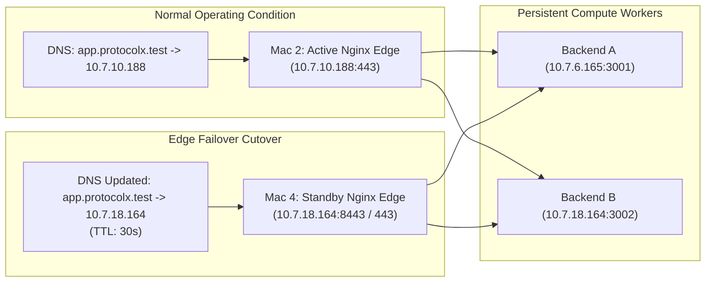

# PROTOCOLX PHASE 2 — STANDBY EDGE MIGRATION & DISASTER RECOVERY

**Document Version:** 2.0.0  
**Active Gateway:** Mac 2 (`10.7.10.188:443`)  
**Standby Gateway:** Mac 4 (`10.7.18.164:8443` / `443`)  
**Lead:** Shagun (Mac 2), Aditya (Mac 4), Naveen (Mac 1)  
**Date:** November 24, 2026  

---

## 1. Architectural Strategy

In the event of hardware failure, kernel panic, or power outage on the primary Nginx Edge gateway (Mac 2), traffic cannot reach either backend worker. 

To eliminate this single point of failure, ProtocolX provides an automated Standby Edge configuration on Mac 4 (`10.7.18.164`).



---

## 2. TLS Certificate Subject Alternative Name (SAN) Validation

A frequent failure mode during disaster recovery migrations is hostname-certificate mismatch (`ERR_CERT_COMMON_NAME_INVALID`).

In ProtocolX, the TLS certificate (`tls/app.protocolx.test.crt`) was generated with domain-level Subject Alternative Names rather than binding to a single machine IP:
```
X509v3 Subject Alternative Name:
    DNS:app.protocolx.test
```
Because the certificate validates the hostname `app.protocolx.test` rather than the underlying network interface, **the exact same certificate and private key are deployed to the Standby Edge on Mac 4**. Clients connecting to the new IP complete TLS 1.3 handshakes without security warnings.

---

## 3. Step-by-Step Cutover Procedure

### Step 1: Start Standby Nginx on Mac 4
```bash
# On Mac 4:
nginx -c /Users/flexer/Documents/Projects/CN/ProtocolX/nginx/nginx_standby.conf
```
Verify port listener:
```bash
lsof -nP -iTCP:8443 -sTCP:LISTEN
```

### Step 2: Update DNS A-Record
On Primary DNS (Mac 1) and Backup DNS (Mac 4), update `app.protocolx.test`:
```bash
# Update dnsmasq mapping:
sudo sed -i '' 's|10.7.10.188|10.7.18.164|' /opt/homebrew/etc/dnsmasq.conf
sudo killall -HUP dnsmasq
```

### Step 3: Flush Resolver Cache
On client machines:
```bash
sudo dscacheutil -flushcache
sudo killall -HUP mDNSResponder
```

### Step 4: Verify Cutover Ingress
```bash
curl -k -i https://app.protocolx.test:8443/api/status
```
Expected response headers:
```http
HTTP/1.1 200 OK
X-Gateway: ProtocolX-Standby-Edge-Mac4
X-Standby-Edge: Active-Standby-Mac4
```
Traffic seamlessly routes to both Backend A and Backend B through the standby edge.
